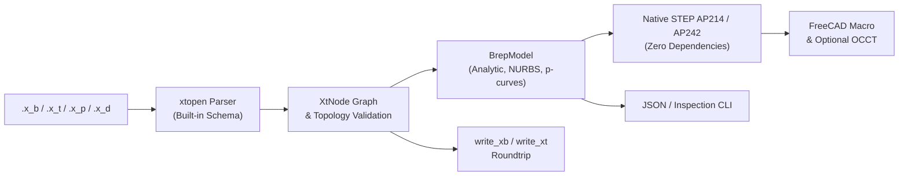

<div align="center">

<picture>
  <source media="(prefers-color-scheme: dark)" srcset="assets/logo-dark.svg">
  <source media="(prefers-color-scheme: light)" srcset="assets/logo-light.svg">
  
</picture>

**Clean-room Parasolid XT (`.x_b`, `.x_t`, `.x_p`, `.x_d`) and Siemens NX (`.prt`) reader, writer, B-rep inspector & native STEP AP214/AP242 exporter.**

**English** · [Русский](docs/i18n/README.ru.md) · [中文](docs/i18n/README.zh-CN.md) · [Deutsch](docs/i18n/README.de.md) · [日本語](docs/i18n/README.ja.md) · [Español](docs/i18n/README.es.md)

[](https://github.com/41Opty41/xtopen/actions/workflows/ci.yml)
[](pyproject.toml)
[-0891B2?style=flat-square)](pyproject.toml)
[](LICENSE)
[](DONATE.md)

</div>

---

## Architecture



## Highlights

- **Zero runtime dependencies** — pure Python 3.10+ standard library (`cadquery-ocp` is strictly optional).
- **Self-contained XT schema** — built-in schema from public XT documentation; no external `.s_t` files needed.
- **Full container support** — Form-1 & Form-2 binary `.x_b`, text `.x_t`, partition `.x_p`, delta `PMARK` streams `.x_d`, plus **Siemens NX `.prt`** (`SPLMSSTR` & legacy `OLE2/CFB`) embedded Parasolid B-rep extraction.
- **Native STEP AP214 / AP242 export** — planes, cylinders, cones, spheres, tori, extruded/revolved/offset surfaces, rational & non-rational NURBS, circles, ellipses, intersection sample curves, 2D p-curve 3D lifting, multi-body shells, **assembly hierarchies (`ASSEMBLY` / `INSTANCE` / `TRANSFORM`)**, and **face/body colors, names & transparency (`SDL/TYSA_*`)** (`--units mm|m`).
- **Roundtrip & CAD integrations** — `write_xb`, `write_xt`, `xb_to_xt`, `xt_to_xb`, optional [`xtopen.occt_bridge`](src/xtopen/occt_bridge.py), [`freecad/ImportParasolid.FCMacro`](freecad/ImportParasolid.FCMacro), companion Rust [SolidCraft plugins & live browser WASM viewer](https://41opty41.github.io/solidcraft-parasolid/).

## Quick Start

```bash
pip install xtopen
# or for optional OpenCASCADE checks:
pip install "xtopen[occt]"

xtopen convert model.x_b model.step --units mm --schema AP214
xtopen info model.x_b
```

```python
import xtopen

parsed = xtopen.load_xb("part.x_b")
report = xtopen.validate(parsed)
xtopen.export_step(parsed, "part.step", schema="AP214", units="mm")
```

For optional OpenCASCADE checks:

```bash
pip install -e ".[occt]"
```

## CLI Commands

| Command | Description |
| --- | --- |
| `xtopen info <file> [--json]` | Show container header, node histogram, topology counts, bounding box, and Euler characteristic |
| `xtopen validate <file> [--json]` | Validate stream completeness, loop vertex closure, edge pairing, and curve/surface bounds |
| `xtopen dump <file> [--nodes-only] [-o out.json]` | Export structured B-rep model or raw XT records to JSON |
| `xtopen convert <in> <out> [--units mm\|m] [--schema AP214\|AP242]` | Convert between `.prt`, `.x_b`, `.x_t`, and `.step`/`.stp` |
| `xtopen extract-prt <file.prt> <out_dir>` | Extract embedded `.x_b` streams (and preview thumbnail) from an NX `.prt` file |

## Supported XT Entities

| Category | Supported Nodes |
| --- | --- |
| Topology | `ASSEMBLY (10)`, `INSTANCE (11)`, `BODY (12)`, `SHELL (13)`, `FACE (14)`, `LOOP (15)`, `EDGE (16)`, `HALFEDGE (17)`, `VERTEX (18)`, `REGION (19)` |
| Surfaces | `PLANE (50)`, `CYLINDER (51)`, `CONE (52)`, `SPHERE (53)`, `TORUS (54)`, `OFFSET_SURF (60)`, `SWEPT_SURF (67)`, `SPUN_SURF (68)`, `B_SURFACE (124)` / `NURBS_SURF (126)` |
| Curves | `LINE (30)`, `CIRCLE (31)`, `ELLIPSE (32)`, `INTERSECTION (38)`, `TRIMMED_CURVE (133)`, `B_CURVE (134)` / `NURBS_CURVE (136)`, `SP_CURVE (137)` |
| Data & Attribs | `POINT (29)`, `LIST (70)`, `ATTRIB_DEF (80)`, `ATTRIBUTE (81)`, `*_VALUES (82..89, 98)`, `TRANSFORM (100)`, `WORLD (101)`, `KEY (102)` |

## Documentation

- [XT Format Technical Notes](docs/FORMAT.md) ([Русская версия](docs/i18n/FORMAT.ru.md))
- [Contributing](CONTRIBUTING.md) · [Changelog](CHANGELOG.md)

## Verified Scope & Known Limitations

- **XT Binary Schema Parity**: Verified `4,251 / 4,251` `.x_b` files (`0` errors, `0` field mismatches) using only the built-in schema, plus `.x_p` and `.x_d` partition/delta containers.
- **STEP Export Validation (OCCT)**: Verified `304 / 304` stratified corpus `.x_b` conversions load cleanly in OpenCASCADE `STEPControl_Reader` (`0` Part-21 syntax errors, `303 / 304 = 99.7%` `BRepCheck_Analyzer.IsValid()`).
- **Known Limitations**: Procedural rolling-ball fillets (`BLENDED_EDGE 56`) have no exact analytic STEP representation and fall back to placeholder planes.

## Support

If `xtopen` helps your work, voluntary donations are welcome ([details](DONATE.md)):
- **Bitcoin (BTC)**: `bc1qqptjmpr684xglyqsp743ruufnwpsjv4dlzk9tx`
- **YooMoney**: [yoomoney.ru/to/4100118415983435](https://yoomoney.ru/to/4100118415983435) (`4100118415983435`)

## License

MIT License — see [`LICENSE`](LICENSE).
