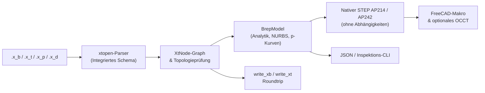

<div align="center">

<picture>
  <source media="(prefers-color-scheme: dark)" srcset="../../assets/logo-dark.svg">
  <source media="(prefers-color-scheme: light)" srcset="../../assets/logo-light.svg">
  
</picture>

**Clean-Room-Parser, Writer, B-Rep-Inspektor und nativer STEP-AP214/AP242-Exporter für Parasolid-XT-Dateien (`.x_b`, `.x_t`, `.x_p`, `.x_d`).**

[English](../../README.md) · [Русский](README.ru.md) · [中文](README.zh-CN.md) · **Deutsch** · [日本語](README.ja.md) · [Español](README.es.md)

[](../../pyproject.toml)
[-0891B2?style=flat-square)](../../pyproject.toml)
[](../../LICENSE)
[](../../DONATE.md)

</div>

---

## Architektur



## Funktionen

- **Keine Laufzeitabhängigkeiten** — reine Python-3.10+-Standardbibliothek (`cadquery-ocp` ist rein optional).
- **Integriertes XT-Schema** — basiert auf öffentlicher XT-Dokumentation; keine externen `.s_t`-Dateien nötig.
- **Vollständige Container-Unterstützung** — binäre Form-1/Form-2 `.x_b`, Text `.x_t`, Partitionen `.x_p` und Delta-Streams `.x_d` (`PMARK`).
- **Nativer STEP-AP214/AP242-Export** — Ebenen, Zylinder, Kegel, Kugeln, Tori, Extrusions-/Rotations-/Offsetflächen, rationale und nicht-rationale NURBS, Kreise, Ellipsen, Schnittkurven, 3D-Lifting von 2D-p-Kurven sowie Mehrkörper-Exports (`--units mm|m`).
- **Roundtrip & CAD-Integrationen** — `write_xb`, `write_xt`, `xb_to_xt`, `xt_to_xb`, optionales [`xtopen.occt_bridge`](../../src/xtopen/occt_bridge.py) und [`freecad/ImportParasolid.FCMacro`](../../freecad/ImportParasolid.FCMacro).

## Schnellstart

```bash
pip install -e .
xtopen convert model.x_b model.step --units mm --schema AP214
xtopen info model.x_b
```

```python
import xtopen

parsed = xtopen.load_xb("part.x_b")
report = xtopen.validate(parsed)
xtopen.export_step(parsed, "part.step", schema="AP214", units="mm")
```

## CLI-Befehle

| Befehl | Beschreibung |
| --- | --- |
| `xtopen info <file> [--json]` | Header, Knotenstatistik, B-Rep-Zähler, Bounding-Box und Euler-Charakteristik anzeigen |
| `xtopen validate <file> [--json]` | Stream-Vollständigkeit, Schleifenschluss, Kantenpaarung und Geometrie prüfen |
| `xtopen dump <file> [--nodes-only] [-o out.json]` | B-Rep-Modell oder rohe XT-Knoten als JSON ausgeben |
| `xtopen convert <in> <out> [--units mm\|m] [--schema AP214\|AP242]` | Zwischen `.x_b`, `.x_t` und `.step`/`.stp` konvertieren |

## Verifizierter Umfang & Einschränkungen

- **XT-Schema-Parität**: `4.251 / 4.251` `.x_b`-Dateien fehlerfrei allein mit dem integrierten Schema geparst.
- **STEP-Export (OCCT)**: `304 / 304` geschichtete Testmodelle lassen sich ohne Part-21-Syntaxfehler in `STEPControl_Reader` laden (`303 / 304 = 99,7%` bestehen `BRepCheck_Analyzer.IsValid()`).
- **Einschränkungen**: Prozedurale Verrundungen `BLENDED_EDGE (56)` fallen mangels analytischer STEP-Entsprechung auf Ersatzebenen zurück; Baugruppen-Transformationen (`INSTANCE`/`TRANSFORM`) werden in `BrepModel.instances` erfasst, jedoch noch nicht als STEP-Baugruppenhierarchie ausgegeben.

## Unterstützung

Wenn Ihnen `xtopen` weiterhilft, freuen wir uns über eine freiwillige Spende ([Details](../../DONATE.md)):
- **Bitcoin (BTC)**: `bc1qqptjmpr684xglyqsp743ruufnwpsjv4dlzk9tx`
- **YooMoney**: [yoomoney.ru/to/4100118415983435](https://yoomoney.ru/to/4100118415983435) (`4100118415983435`)

## Dokumentation & Lizenz

- [XT-Formatspezifikation (EN)](../FORMAT.md) · [Mitwirken](../../CONTRIBUTING.md) · [Changelog](../../CHANGELOG.md)
- MIT-Lizenz — siehe [`LICENSE`](../../LICENSE).
