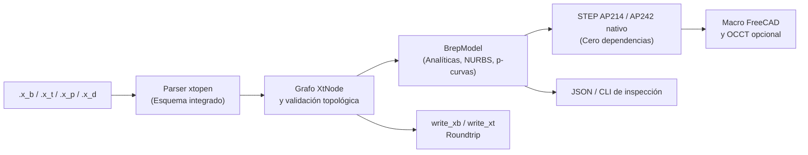

<div align="center">

<picture>
  <source media="(prefers-color-scheme: dark)" srcset="../../assets/logo-dark.svg">
  <source media="(prefers-color-scheme: light)" srcset="../../assets/logo-light.svg">
  
</picture>

**Lector, escritor, inspector B-rep y exportador nativo STEP AP214/AP242 en implementación clean-room para archivos Parasolid XT (`.x_b`, `.x_t`, `.x_p`, `.x_d`).**

[English](../../README.md) · [Русский](README.ru.md) · [中文](README.zh-CN.md) · [Deutsch](README.de.md) · [日本語](README.ja.md) · **Español**

[](../../pyproject.toml)
[-0891B2?style=flat-square)](../../pyproject.toml)
[](../../LICENSE)
[](../../DONATE.md)

</div>

---

## Arquitectura



## Características principales

- **Cero dependencias externas** — utiliza únicamente la biblioteca estándar de Python 3.10+ (`cadquery-ocp` es estrictamente opcional).
- **Esquema XT integrado** — basado en documentación pública de XT; no requiere archivos `.s_t` propietarios.
- **Soporte completo de contenedores** — binarios Form-1 y Form-2 `.x_b`, texto `.x_t`, particiones `.x_p` y flujos delta `.x_d` (`PMARK`).
- **Exportación nativa STEP AP214 / AP242** — planos, cilindros, conos, esferas, toros, superficies extruidas/revolucionadas/offset, NURBS racionales y no racionales, círculos, elipses, curvas de intersección muestreadas, elevación 3D de p-curvas 2D y sólidos multicuerpo (`--units mm|m`).
- **Conversión e integraciones CAD** — `write_xb`, `write_xt`, `xb_to_xt`, `xt_to_xb`, módulo opcional [`xtopen.occt_bridge`](../../src/xtopen/occt_bridge.py) y macro [`freecad/ImportParasolid.FCMacro`](../../freecad/ImportParasolid.FCMacro).

## Inicio rápido

```bash
pip install -e .
xtopen convert model.x_b model.step --units mm --schema AP214
xtopen info model.x_b
```

```python
import xtopen

parsed = xtopen.load_xb("part.x_b")
report = xtopen.validate(parsed)
xtopen.export_step(parsed, "part.step", schema="AP214", units="mm")
```

## Alcance verificado y limitaciones

- **Paridad del esquema XT**: `4.251 / 4.251` archivos `.x_b` procesados sin errores ni discrepancias usando solo el esquema integrado.
- **Validación de exportación STEP (OCCT)**: `304 / 304` modelos estratificados se cargan sin errores de sintaxis Part-21 en `STEPControl_Reader` (`303 / 304 = 99,7%` superan `BRepCheck_Analyzer.IsValid()`).
- **Limitaciones**: los redondeos procedurales `BLENDED_EDGE (56)` se exportan como planos de respaldo; las transformaciones `INSTANCE`/`TRANSFORM` se extraen en `BrepModel.instances` sin expandir aún jerarquías de ensamblaje en STEP.

## Apoyar el proyecto

Si `xtopen` te resulta útil, puedes apoyar el desarrollo con una donación voluntaria ([detalles](../../DONATE.md)):
- **Bitcoin (BTC)**: `bc1qqptjmpr684xglyqsp743ruufnwpsjv4dlzk9tx`
- **YooMoney**: [yoomoney.ru/to/4100118415983435](https://yoomoney.ru/to/4100118415983435) (`4100118415983435`)

## Documentación y licencia

- [Notas técnicas del formato XT (EN)](../FORMAT.md) · [Contribuir](../../CONTRIBUTING.md) · [Historial de cambios](../../CHANGELOG.md)
- Licencia MIT — consulta [`LICENSE`](../../LICENSE).
