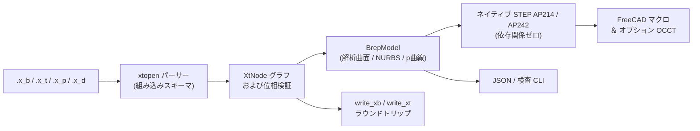

<div align="center">

<picture>
  <source media="(prefers-color-scheme: dark)" srcset="../../assets/logo-dark.svg">
  <source media="(prefers-color-scheme: light)" srcset="../../assets/logo-light.svg">
  
</picture>

**クリーンルーム実装の Parasolid XT（`.x_b`, `.x_t`, `.x_p`, `.x_d`）パーサー・ライター・B-rep 検証＆ネイティブ STEP AP214/AP242 エクスポーター。**

[English](../../README.md) · [Русский](README.ru.md) · [中文](README.zh-CN.md) · [Deutsch](README.de.md) · **日本語** · [Español](README.es.md)

[](../../pyproject.toml)
[-0891B2?style=flat-square)](../../pyproject.toml)
[](../../LICENSE)
[](../../DONATE.md)

</div>

---

## アーキテクチャ



## 主な機能

- **外部依存ゼロ** — Python 3.10+ 標準ライブラリのみで動作（`cadquery-ocp` はオプション）。
- **組み込み XT スキーマ** — 公開仕様に基づく自己完結スキーマにより外部 `.s_t` ファイル不要。
- **全 XT コンテナ対応** — Form-1 / Form-2 バイナリ `.x_b`、テキスト `.x_t`、パーティション `.x_p`、デルタストリーム `.x_d`（`PMARK`）に対応。
- **ネイティブ STEP AP214 / AP242 出力** — 平面・円柱・円錐・球・トーラス・押し出し/回転/オフセット曲面、有理・非有理 NURBS、円・楕円・交線サンプル曲線、2D p曲線の 3D リフティング、マルチボディ出力（`--units mm|m`）。
- **相互変換＆ CAD 連携** — `write_xb`、`write_xt`、`xb_to_xt`、`xt_to_xb`、オプションの [`xtopen.occt_bridge`](../../src/xtopen/occt_bridge.py)、[`freecad/ImportParasolid.FCMacro`](../../freecad/ImportParasolid.FCMacro)。

## クイックスタート

```bash
pip install -e .
xtopen convert model.x_b model.step --units mm --schema AP214
xtopen info model.x_b
```

```python
import xtopen

parsed = xtopen.load_xb("part.x_b")
report = xtopen.validate(parsed)
xtopen.export_step(parsed, "part.step", schema="AP214", units="mm")
```

## 検証済み範囲と制限事項

- **XT スキーマ整合性**：組み込みスキーマのみで `4,251 / 4,251` 件の `.x_b` ファイルをエラーゼロで解析。
- **STEP 出力検証（OCCT）**：層化抽出 `304 / 304` 件すべてが OpenCASCADE `STEPControl_Reader` で構文エラーなく読み込まれ、`303 / 304 (99.7%)` が `BRepCheck_Analyzer.IsValid()` を通過。
- **制限事項**：プロシージャルフィレット `BLENDED_EDGE (56)` は解析的な STEP 表現がないため代替平面として出力されます。`INSTANCE`/`TRANSFORM` は `BrepModel.instances` に抽出されますが、STEP アセンブリ階層の展開には未対応です。

## サポート・寄付

`xtopen` がお役に立ちましたら、任意のご支援をお待ちしております（[詳細](../../DONATE.md)）：
- **Bitcoin (BTC)**: `bc1qqptjmpr684xglyqsp743ruufnwpsjv4dlzk9tx`
- **YooMoney**: [yoomoney.ru/to/4100118415983435](https://yoomoney.ru/to/4100118415983435) (`4100118415983435`)

## ドキュメント・ライセンス

- [XT フォーマット技術解説 (EN)](../FORMAT.md) · [コントリビュート](../../CONTRIBUTING.md) · [変更履歴](../../CHANGELOG.md)
- MIT ライセンス — [`LICENSE`](../../LICENSE) を参照。
