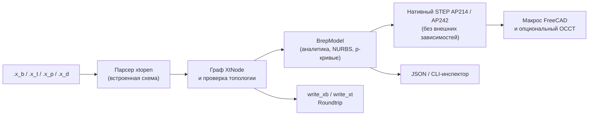

<div align="center">

<picture>
  <source media="(prefers-color-scheme: dark)" srcset="../../assets/logo-dark.svg">
  <source media="(prefers-color-scheme: light)" srcset="../../assets/logo-light.svg">
  
</picture>

**Clean-room парсер, писатель, B-rep инспектор и нативный экспортёр STEP AP214/AP242 для файлов Parasolid XT (`.x_b`, `.x_t`, `.x_p`, `.x_d`).**

[English](../../README.md) · **Русский** · [中文](README.zh-CN.md) · [Deutsch](README.de.md) · [日本語](README.ja.md) · [Español](README.es.md)

[](../../pyproject.toml)
[-0891B2?style=flat-square)](../../pyproject.toml)
[](../../LICENSE)
[](../../DONATE.md)

</div>

---

## Архитектура



## Ключевые особенности

- **Нулевые внешние зависимости** — работает на чистой стандартной библиотеке Python 3.10+ (`cadquery-ocp` требуется только для опционального моста OCCT).
- **Встроенная схема XT** — не требует внешних проприетарных файлов схем `.s_t`.
- **Все контейнеры Parasolid XT** — бинарные Form-1 и Form-2 `.x_b`, текстовые `.x_t`, разделы `.x_p` и дельта-потоки `.x_d` с транзакциями `PMARK`.
- **Нативный экспорт STEP AP214 / AP242** — плоскости, цилиндры, конусы, сферы, торы, поверхности выдавливания/вращения/смещения, рациональные и нерациональные NURBS, окружности, эллипсы, сэмплированные кривые пересечения, 3D-подъём 2D p-кривых и многотельные оболочки (`--units mm|m`).
- **Инструменты конвертации и интеграции** — `write_xb`, `write_xt`, `xb_to_xt`, `xt_to_xb`, опциональный [`xtopen.occt_bridge`](../../src/xtopen/occt_bridge.py) и макрос [`freecad/ImportParasolid.FCMacro`](../../freecad/ImportParasolid.FCMacro).

## Быстрый старт

```bash
pip install -e .
xtopen convert model.x_b model.step --units mm --schema AP214
xtopen info model.x_b
```

```python
import xtopen

parsed = xtopen.load_xb("part.x_b")
report = xtopen.validate(parsed)
xtopen.export_step(parsed, "part.step", schema="AP214", units="mm")
```

С опциональной поддержкой OpenCASCADE:

```bash
pip install -e ".[occt]"
```

## Команды CLI

| Команда | Назначение |
| --- | --- |
| `xtopen info <file> [--json]` | Вывести заголовок, гистограмму узлов, статистику B-rep, габариты и характеристику Эйлера |
| `xtopen validate <file> [--json]` | Проверить целостность потока, замкнутость контуров, сопряжение рёбер и геометрические параметры |
| `xtopen dump <file> [--nodes-only] [-o out.json]` | Выгрузить извлечённый B-rep граф или сырые узлы XT в JSON |
| `xtopen convert <in> <out> [--units mm\|m] [--schema AP214\|AP242]` | Конвертировать между `.x_b`, `.x_t` и `.step`/`.stp` |

## Поддерживаемые сущности XT

| Категория | Поддерживаемые узлы |
| --- | --- |
| Топология | `ASSEMBLY (10)`, `INSTANCE (11)`, `BODY (12)`, `SHELL (13)`, `FACE (14)`, `LOOP (15)`, `EDGE (16)`, `HALFEDGE (17)`, `VERTEX (18)`, `REGION (19)` |
| Поверхности | `PLANE (50)`, `CYLINDER (51)`, `CONE (52)`, `SPHERE (53)`, `TORUS (54)`, `OFFSET_SURF (60)`, `SWEPT_SURF (67)`, `SPUN_SURF (68)`, `B_SURFACE (124)` / `NURBS_SURF (126)` |
| Кривые | `LINE (30)`, `CIRCLE (31)`, `ELLIPSE (32)`, `INTERSECTION (38)`, `TRIMMED_CURVE (133)`, `B_CURVE (134)` / `NURBS_CURVE (136)`, `SP_CURVE (137)` |
| Данные и атрибуты | `POINT (29)`, `LIST (70)`, `ATTRIB_DEF (80)`, `ATTRIBUTE (81)`, `*_VALUES (82..89, 98)`, `TRANSFORM (100)`, `WORLD (101)`, `KEY (102)` |

## Документация

- [Техническое описание формата XT (на русском)](FORMAT.ru.md) · [English](../FORMAT.md)
- [Участие в разработке](../../CONTRIBUTING.md) · [История изменений](../../CHANGELOG.md)

## Проверенная область и ограничения

- **Паритет бинарной схемы XT**: проверено `4 251 / 4 251` файлов `.x_b` (`0` ошибок, `0` расхождений полей) исключительно на встроенной схеме, а также контейнеры `.x_p` и `.x_d`.
- **Проверка экспорта в STEP (OCCT)**: проверено `304 / 304` стратифицированных реальных `.x_b` файла через `OpenCASCADE STEPControl_Reader` (`0` синтаксических ошибок Part-21, `303 / 304 = 99.7%` прошли `BRepCheck_Analyzer.IsValid()`).
- **Известные ограничения**: процедурные скругления `BLENDED_EDGE (56)` не имеют точного аналитического аналога в STEP и заменяются заглушками; трансформации сборок `INSTANCE`/`TRANSFORM` извлекаются в `BrepModel.instances`, но иерархические STEP-сборки пока не формируются.

## Поддержать проект

Если `xtopen` экономит вам время, проект можно добровольно поддержать ([подробнее](../../DONATE.md)):
- **Bitcoin (BTC)**: `bc1qqptjmpr684xglyqsp743ruufnwpsjv4dlzk9tx`
- **ЮMoney**: [yoomoney.ru/to/4100118415983435](https://yoomoney.ru/to/4100118415983435) (кошелёк `4100118415983435`)

## Лицензия

Лицензия MIT — см. [`LICENSE`](../../LICENSE).
