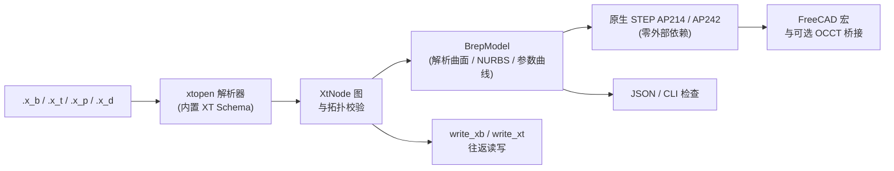

<div align="center">

<picture>
  <source media="(prefers-color-scheme: dark)" srcset="../../assets/logo-dark.svg">
  <source media="(prefers-color-scheme: light)" srcset="../../assets/logo-light.svg">
  
</picture>

**净室级 Parasolid XT（`.x_b`、`.x_t`、`.x_p`、`.x_d`）解析器、写入器、B-rep 检查工具与原生 STEP AP214/AP242 导出器。**

[English](../../README.md) · [Русский](README.ru.md) · **中文** · [Deutsch](README.de.md) · [日本語](README.ja.md) · [Español](README.es.md)

[](../../pyproject.toml)
[-0891B2?style=flat-square)](../../pyproject.toml)
[](../../LICENSE)
[](../../DONATE.md)

</div>

---

## 架构概览



## 核心特性

- **零运行时依赖** — 仅依赖 Python 3.10+ 标准库（`cadquery-ocp` 为可选项）。
- **自包含内置 Schema** — 基于公开 XT 文档构建，无需外部 `.s_t` 文件。
- **完整容器支持** — Form-1 / Form-2 二进制 `.x_b`、文本 `.x_t`、分区传输 `.x_p` 及增量事务 `.x_d`（`PMARK`）。
- **原生 STEP AP214 / AP242 导出** — 支持平面、圆柱面、圆锥面、球面、圆环面、拉伸/旋转/偏置曲面、有理与非有理 NURBS、圆、椭圆、交线采样曲线、二维 p-curve 升维及多实体壳体（`--units mm|m`）。
- **往返读写与 CAD 集成** — 提供 `write_xb`、`write_xt`、`xb_to_xt`、`xt_to_xb`、可选 [`xtopen.occt_bridge`](../../src/xtopen/occt_bridge.py) 以及 [`freecad/ImportParasolid.FCMacro`](../../freecad/ImportParasolid.FCMacro)。

## 快速开始

```bash
pip install -e .
xtopen convert model.x_b model.step --units mm --schema AP214
xtopen info model.x_b
```

```python
import xtopen

parsed = xtopen.load_xb("part.x_b")
report = xtopen.validate(parsed)
xtopen.export_step(parsed, "part.step", schema="AP214", units="mm")
```

如需启用可选 OpenCASCADE 校验与桥接：

```bash
pip install -e ".[occt]"
```

## CLI 命令

| 命令 | 说明 |
| --- | --- |
| `xtopen info <file> [--json]` | 显示文件头信息、节点统计、B-rep 数量、包围盒与欧拉示性数 |
| `xtopen validate <file> [--json]` | 校验数据流完整性、环路闭合性、半边配对与几何合法性 |
| `xtopen dump <file> [--nodes-only] [-o out.json]` | 导出 B-rep 模型或原始 XT 节点流为 JSON |
| `xtopen convert <in> <out> [--units mm\|m] [--schema AP214\|AP242]` | 在 `.x_b`、`.x_t` 与 `.step`/`.stp` 之间转换 |

## 支持的 XT 实体

| 类别 | 支持节点 |
| --- | --- |
| 拓扑 | `ASSEMBLY (10)`, `INSTANCE (11)`, `BODY (12)`, `SHELL (13)`, `FACE (14)`, `LOOP (15)`, `EDGE (16)`, `HALFEDGE (17)`, `VERTEX (18)`, `REGION (19)` |
| 曲面 | `PLANE (50)`, `CYLINDER (51)`, `CONE (52)`, `SPHERE (53)`, `TORUS (54)`, `OFFSET_SURF (60)`, `SWEPT_SURF (67)`, `SPUN_SURF (68)`, `B_SURFACE (124)` / `NURBS_SURF (126)` |
| 曲线 | `LINE (30)`, `CIRCLE (31)`, `ELLIPSE (32)`, `INTERSECTION (38)`, `TRIMMED_CURVE (133)`, `B_CURVE (134)` / `NURBS_CURVE (136)`, `SP_CURVE (137)` |
| 数据与属性 | `POINT (29)`, `LIST (70)`, `ATTRIB_DEF (80)`, `ATTRIBUTE (81)`, `*_VALUES (82..89, 98)`, `TRANSFORM (100)`, `WORLD (101)`, `KEY (102)` |

## 文档与验证范围

- [XT 格式技术说明](../FORMAT.md) · [参与贡献](../../CONTRIBUTING.md) · [更新日志](../../CHANGELOG.md)
- **XT Schema 一致性**：仅使用内置 Schema 通过 `4,251 / 4,251` 份 `.x_b` 语料测试（零错误、零字段偏差）。
- **STEP 导出校验（OCCT）**：`304 / 304` 分层抽样模型可被 OpenCASCADE `STEPControl_Reader` 无语法错误读取，其中 `303 / 304 (99.7%)` 通过 `BRepCheck_Analyzer.IsValid()`。
- **已知限制**：过程化倒角面 `BLENDED_EDGE (56)` 暂以占位平面导出；装配实例 `INSTANCE`/`TRANSFORM` 已提取至 `BrepModel.instances`，尚未生成 STEP 装配层级结构。

## 赞助与支持

如果 `xtopen` 对您的工作有所帮助，欢迎自愿捐赠支持开发（[详情](../../DONATE.md)）：
- **Bitcoin (BTC)**：`bc1qqptjmpr684xglyqsp743ruufnwpsjv4dlzk9tx`
- **YooMoney**：[yoomoney.ru/to/4100118415983435](https://yoomoney.ru/to/4100118415983435)（`4100118415983435`）

## 许可证

MIT 许可证 — 详见 [`LICENSE`](../../LICENSE)。
